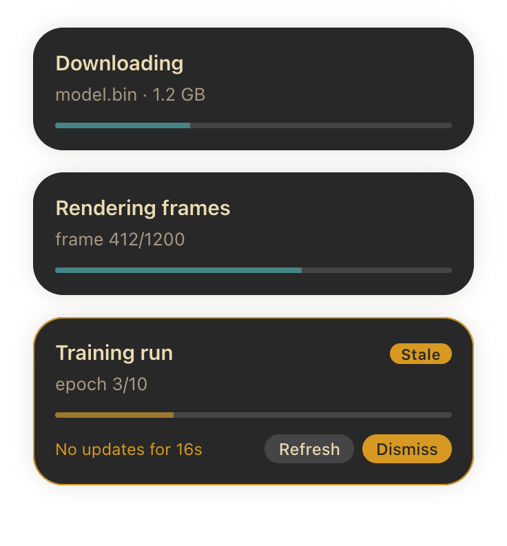

# Job Overview

Progress cards for long-running jobs on your macOS desktop. Job Overview is an
[Übersicht](https://tracesof.net/uebersicht/) widget, and your scripts feed it through
the `uebersicht-job-overview-notifier` Python package.



| Folder                      | What it is                                           |
|-----------------------------|------------------------------------------------------|
| `widget/job-overview.widget` | The Übersicht widget                                 |
| `python/`                   | [`uebersicht-job-overview-notifier`](python/README.md) on PyPI: client library and local server |
| `PROTOCOL.md`               | The WebSocket protocol both sides speak              |

## Install

1. **Widget:** download `job-overview.widget.zip` from the
   [latest release](https://github.com/paraversal/uebersicht-job-overview/releases/latest)
   and unzip it into your Übersicht widgets folder (Übersicht menu → *Open Widgets Folder*).
2. **Python package:**

   ```bash
   pip install uebersicht-job-overview-notifier
   ```

3. Use it:

   ```python
   from taskoverview_notifier import SyncNotifier

   with SyncNotifier() as notifier, notifier.job("Hello", "from Python") as job:
       job.update(progress=0.5)
   ```

The first script that runs starts a small background server on `localhost:6789`.
The widget connects to it and reconnects on its own if the server goes away. There's
no need to refresh Übersicht.

## Stale jobs

If the process behind a card crashes, is killed, hangs, or (with `stale_after=`)
simply stops sending updates, the card turns **stale**. It gets a yellow outline,
shows what happened, and offers two buttons:

- **Refresh** gets the latest state from the server, or reconnects right away if the
  server is down.
- **Dismiss** removes the card.

> Übersicht widgets only receive clicks when interaction is enabled for them. If the
> buttons don't respond, check Übersicht's preferences (interaction shortcut / widget
> layer).

See the [Python README](python/README.md#stale-jobs) for exactly how staleness is detected.

## Configuration

Settings are at the top of `widget/job-overview.widget/index.jsx`: server URL,
position, card width, spacing and the colour theme (Gruvbox dark by default).

## Development

```bash
# widget: symlink the repo copy into Übersicht
ln -s "$PWD/widget/job-overview.widget" "$HOME/Library/Application Support/Übersicht/widgets/job-overview.widget"

# python
cd python
uv sync
uv run pytest
uv run ruff check src tests && uv run mypy
uv run taskoverview-server --log-level DEBUG   # run the server in the foreground
```

### Releasing

- **Python:** bump `__version__` in `python/src/taskoverview_notifier/__init__.py` and
  push a tag `py-v<version>`. CI builds the package and publishes it to PyPI through
  trusted publishing.
- **Widget:** push a tag `widget-v<version>`. CI attaches `job-overview.widget.zip` to a
  GitHub release.

## License

GPL-3.0-or-later. See [LICENSE](LICENSE).
